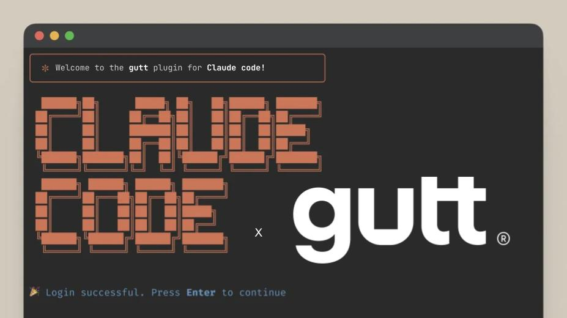

<p align="center">
  
</p>

# gutt plugins for Claude Code

Organizational memory for Claude Code: the decisions, lessons and context your team has
recorded, searched before work and captured after it. [gutt](https://gutt.pro) keeps that
memory as a knowledge graph; this marketplace, `gutt-plugins`, holds the plugins that connect
Claude Code to it.

| Plugin                                     | For                                    | What it adds                                                                         | Install                                             |
| ------------------------------------------ | -------------------------------------- | ------------------------------------------------------------------------------------ | --------------------------------------------------- |
| [gutt-pro](gutt-core/README.md)            | Everyone; install it first             | Memory search and capture, session hooks, the status bar, the `/gutt-pro:` settings  | `claude plugin install gutt-pro@gutt-plugins`       |
| [gutt-developer](gutt-developer/README.md) | Developers                             | Ticket research, duplicates, estimates, bug triage, sub-task breakdown, PR review    | `claude plugin install gutt-developer@gutt-plugins` |
| [gutt-product](gutt-product/README.md)     | Product leads                          | Stories from meetings and documents, backlog dedupe, evidence-backed prioritization  | `claude plugin install gutt-product@gutt-plugins`   |
| [gutt-mentor](gutt-mentor/README.md)       | New joiners and anyone growing a skill | Onboarding plans and growth programs, tracked in your personal memory                | `claude plugin install gutt-mentor@gutt-plugins`    |
| gutt-vaults                                | Public research vaults                 | Coming. Curated, reviewed research on a public topic, run on the shared stage server | Not published yet                                   |

The role plugins depend on `gutt-pro` and install it with them.

## Where it runs

- Claude Code in the terminal
- The Claude desktop app's Code tab
- Cowork
- Cloud routines
- Cursor, in part: see [Cursor](#cursor)

## Start in three steps

1. **Add the marketplace** (once per machine):

   ```
   claude plugin marketplace add iBrain-BVBA/gutt-claude-code-plugin
   ```

2. **Install gutt-pro:**

   ```
   claude plugin install gutt-pro@gutt-plugins
   ```

3. **Sign in and take the tour.** Restart Claude Code, or run `/reload-plugins`. Open the
   connector list and click **Authorise** on the gutt connector, `gutt-mcp-remote`. In the
   terminal the list is `/mcp`: pick `gutt-mcp-remote` and choose Authenticate. Then run
   `/gutt-pro:onboard`.

The connector points at the gutt shared stage server. The first time you authorise it, that
creates your login there; there is nothing to sign up for first.

Then add the role plugins that fit your work:

```
claude plugin install gutt-developer@gutt-plugins
claude plugin install gutt-product@gutt-plugins
claude plugin install gutt-mentor@gutt-plugins
```

[docs/team-onboarding.md](docs/team-onboarding.md) has the same steps in more detail,
including a stale catalogue and the admin-managed rollout for teams.

### Desktop app, Cowork and cloud routines

- **Desktop Code tab and Cowork:** add the marketplace `iBrain-BVBA/gutt-claude-code-plugin`
  and install `gutt-pro` from the app's plugin settings, then click Authorise on
  `gutt-mcp-remote` in the app's connector list.
- **Cloud routines** load the plugins the repository declares in `.claude/settings.json`:

  ```json
  {
    "extraKnownMarketplaces": {
      "gutt-plugins": {
        "source": { "source": "github", "repo": "iBrain-BVBA/gutt-claude-code-plugin" }
      }
    },
    "enabledPlugins": { "gutt-pro@gutt-plugins": true }
  }
  ```

  Add each role plugin the routine needs to `enabledPlugins` the same way.

In Cowork and cloud routines, the `/gutt-pro:` settings last one session, and the status bar is
not shown.

## What runs on its own

Only `gutt-pro` has hooks. Each, in one line:

- **Session start:** opens a session record and checks, in the background, that a gutt server
  is configured. It does not search memory.
- **Each prompt:** applies `/gutt-pro:` settings commands. On a new session or after a
  compaction it adds a pointer to memory search. It does not search by itself, and it does not
  fire on every prompt.
- **After a gutt tool call:** notes whether the call worked, for the status bar. It does not
  change the result.
- **End of turn:** asks a separate `claude -p` call whether the turn produced something worth
  keeping, and if so points Claude at memory capture. It writes nothing itself, and it is
  skipped while recall is off.
- **Session end:** closes the session record.

No hook edits, formats or lints your files. Details: [docs/hooks.md](docs/hooks.md).

**Captures** are typed. Insight and Incident are written directly; Lesson, Decision and
WorkingAgreement wait for you to confirm. `/gutt-pro:mode hitl` makes every capture wait.

## Try it

**gutt-pro** ([more](gutt-core/README.md))

- "What did we decide about authentication last quarter, and why?"
- "Before I start on the billing export, what do we already know about it?"
- "Remember that the staging database resets every Sunday night."

**gutt-developer** ([more](gutt-developer/README.md))

- "Research PROJ-123 before I start on it."
- "Is PROJ-456 a duplicate of anything?"
- "Review PR 812 against what we already know about this code."

**gutt-product** ([more](gutt-product/README.md))

- "Turn yesterday's planning call transcript into stories."
- "Find duplicates in project = PROJ AND status = Backlog."
- "Rank the top 20 backlog items and give me a one-page summary for leadership."

**gutt-mentor** ([more](gutt-mentor/README.md))

- "I'm joining the payments team next week. Help me get up to speed."
- "I want to get better at code reviews."
- "Check in on my onboarding plan."

## Settings

Type these in a session. They take effect before Claude reads your prompt.

| Command                     | Effect                                                                          |
| --------------------------- | ------------------------------------------------------------------------------- |
| `/gutt-pro:onboard`         | Guided tour: connection check, a search, a capture                              |
| `/gutt-pro:health`          | What registered, and whether memory is reachable                                |
| `/gutt-pro:config`          | Show the stored settings and the state they add up to                           |
| `/gutt-pro:off`             | Recall off for this session; `/gutt-pro:off 30` for 30 minutes                  |
| `/gutt-pro:disable`         | Recall off until `/gutt-pro:on`, across restarts                                |
| `/gutt-pro:on`              | Clear an off, a snooze and a disable                                            |
| `/gutt-pro:mode auto\|hitl` | Write captures directly, or confirm each one                                    |
| `/gutt-pro:statusline`      | Add the status bar ([docs/statusline.md](docs/statusline.md))                   |
| `/gutt-pro:agent-scope`     | Bind the memory scope named workflows use in this directory                     |
| `/gutt-pro:setup`           | Point the plugin at your organization's endpoint; `/gutt-pro:start` is the same |

More on each in the [gutt-pro README](gutt-core/README.md#commands).

## Cursor

Install with `/add-plugin` and the repository URL
`https://github.com/iBrain-BVBA/gutt-claude-code-plugin`, then run `/gutt-pro:setup` with your
memory endpoint, restart, and connect `gutt-mcp-remote` under Settings → Tools & MCP Servers.

| Works in Cursor                                          | Does not                                                                          |
| -------------------------------------------------------- | --------------------------------------------------------------------------------- |
| Memory tools, once `gutt-mcp-remote` is connected        | The stage default: Cursor needs `/gutt-pro:setup` and an endpoint                 |
| The skills, including the role plugins'                  | The status bar and `/gutt-pro:statusline`                                         |
| The `gutt-memory.mdc` rule (search first, capture after) | The end-of-turn capture judge, unless the `claude` CLI is installed and signed in |
| `/gutt-pro:setup`, which writes `~/.cursor/mcp.json`     | The `mcp_url` plugin option                                                       |

## Requirements

- Claude Code 2.1.154 or later, or Cursor 2.5 or later
- Node.js 24 or later on the machine that runs the hooks
- macOS, Linux or Windows (PowerShell or Git Bash); nothing extra to configure on Windows

## Troubleshooting

- **`Marketplace "gutt-plugins" not found`:** step 1 was skipped.
- **Install says the plugin is not in the marketplace:** run
  `claude plugin marketplace update gutt-plugins` and retry.
- **Install fails with `path not found`:** the marketplace was added by a direct
  `marketplace.json` URL. Remove it with `claude plugin marketplace remove gutt-plugins` and add
  it again as in step 1.
- **Commands missing right after installing:** run `/reload-plugins`, or restart.
- **Memory tools missing, or the status bar shows `auth needed`:** open `/mcp`, pick
  `gutt-mcp-remote` and authorise again.
- **Nothing is recalled or captured:** `/gutt-pro:config` shows the state; `/gutt-pro:on` clears
  an off, a snooze and a disable.
- **Personal or team login?** Authorising the default connector gives you a personal login on
  the shared stage server, for trying gutt and for public vaults. Your team's memory lives on
  your organization's own endpoint: get the URL from your admin and run `/gutt-pro:setup`, then
  authorise again. [gutt.pro](https://gutt.pro) has the details for organizations.
- **Hook errors:** see `hook-errors.log` in the plugin's data directory
  ([docs/runtime-state-convention.md](docs/runtime-state-convention.md)).

More in [docs/team-onboarding.md](docs/team-onboarding.md#troubleshooting). Upgrading from 2.x
or 3.0: [docs/migration-3.0.md](docs/migration-3.0.md).

## Contributing

See [CONTRIBUTING.md](CONTRIBUTING.md) for local setup, tests, evals, version sync and
releases. Report problems in the
[issue tracker](https://github.com/iBrain-BVBA/gutt-claude-code-plugin/issues).

## License

MIT; see [LICENSE](LICENSE).
